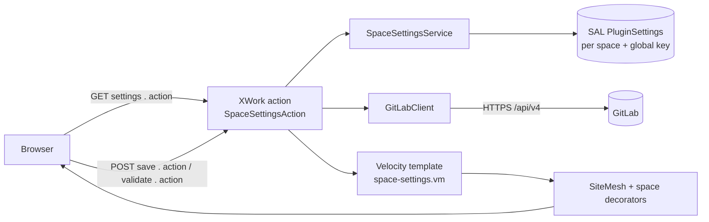

# Architecture

> **Verified against code at commit `05bbcef` (2026-10-29).**

## Scope

The plugin has one job: keep GitLab repository settings per Confluence space and let a space
administrator verify that the token can read the project and branch. There is no page export,
no REST module, and no browser-side JavaScript.

## Runtime shape

It is a single OSGi plugin (plugin key `ru.mts.confluence.page-review`) loaded by Confluence.
Everything runs in the Confluence JVM; GitLab is contacted only from the validation action.



## Components

| Component                                     | Responsibility                                                                         | Key facts                                                                                     |
|-----------------------------------------------|----------------------------------------------------------------------------------------|-----------------------------------------------------------------------------------------------|
| `SpaceSettingsAction`                         | Controller for all three actions; form validation; token resolution; message selection | Extends `AbstractSpaceAdminAction`; POST-only for `doSave`/`doValidate` (`@PermittedMethods`) |
| `SpaceSettingsService`                        | Reads/writes SAL `PluginSettings`; branch-name validation; owns the cipher             | Only class that returns plaintext tokens (`getToken`)                                         |
| `TokenCipher`                                 | AES-256-GCM encryption/decryption of the access token                                  | Random 12-byte IV, 128-bit tag, `v1:` format                                                  |
| `GitLabRepo`                                  | Parses and validates repository URLs; derives API base and project path                | HTTPS only; optional host allowlist                                                           |
| `GitLabClient`                                | Minimal GitLab REST v4 client (`checkProject`, `checkBranch`)                          | `java.net.http.HttpClient`; never follows redirects                                           |
| `GitLabException`                             | Carries HTTP status, or `-1` when GitLab was unreachable                               | Status drives the i18n message                                                                |
| `PageReviewJavaConfig` + `plugin-context.xml` | Spring Java config and OSGi bean wiring                                                | Registers `PluginSettingsFactory` and `SpaceSettingsService`                                  |
| `atlassian-plugin.xml`                        | i18n bundle, Space Tools web item, XWork module                                        | Three actions in namespace `/plugins/page-review`                                             |
| `space-settings.vm`                           | Server-rendered settings form                                                          | Velocity; asks SiteMesh for the standard layout                                               |

## File map

```
pom.xml                                              Maven/AMPS configuration
src/main/resources/atlassian-plugin.xml              plugin descriptor (web item, XWork)
src/main/resources/META-INF/spring/plugin-context.xml component scan for the Java config
src/main/java/ru/mts/confluence/config/PageReviewJavaConfig.java  Spring beans
src/main/java/ru/mts/confluence/web/SpaceSettingsAction.java      controller
src/main/java/ru/mts/confluence/settings/             persistence + crypto
src/main/java/ru/mts/confluence/gitlab/               URL parsing + GitLab client
src/main/resources/templates/page-review/space-settings.vm        view
src/main/resources/page-review.properties             English strings
src/main/resources/page-review_ru.properties          Russian strings
src/test/java/ru/mts/confluence/                      JUnit 4 tests
docs/                                                 this wiki
```

## Request flows

### GET `settings.action` (open the page)

1. XWork invokes `SpaceSettingsAction.doDefault`, which calls `super.doDefault()` and then
   `loadFromStore()`.
2. `SpaceSettingsService.get(spaceKey)` returns a `SpaceSettings` value object: repository URL,
   target branch, and a `tokenSet` boolean. The plaintext token is never exposed to the view.
3. The action returns `SUCCESS` and the Velocity template renders the form.
4. SiteMesh applies the standard `main` decorator (requested by a meta tag in the template), and
   the space decorators add the sidebar and the Space Tools panel. See
   [`ui-and-rendering.md`](ui-and-rendering.md) — this step is easy to break.

### POST `save.action` (persist settings)

1. `doSave` trims the repository URL and branch, then validates: `GitLabRepo.parse`,
   `SpaceSettingsService.isValidBranch`, and a token (required only when none is stored yet).
2. On errors it returns `INPUT`, sets field errors, preserves `tokenSet`, and re-renders the same
   template.
3. On success it calls `settingsService.save`, clears the token field, reloads from the store,
   sets `saved = true`, and renders the template.

A blank token on save keeps the existing ciphertext; the service never deletes a token via blank
input.

### POST `validate.action` (Check connection)

1. `doValidate` marks the form as checked and validates the *currently entered* values without
   saving them.
2. It resolves the effective token: the trimmed form value when non-empty, otherwise
   `settingsService.getToken(spaceKey)`.
3. `GitLabClient.checkProject()` requires the project to be readable; then
   `GitLabClient.checkBranch(branch)` requires the branch to exist.
4. Failures are mapped from the HTTP status (or `-1`) to an i18n message; a 404 from the branch
   call gets a branch-specific message that includes the branch name.
5. The template is rendered with `checked`, `checkOk`, and `checkMessage`.

Detailed URL rules, endpoints, and error mapping: [`gitlab-integration.md`](gitlab-integration.md).

## Wiring: descriptor → Spring → OSGi

1. `META-INF/spring/plugin-context.xml` component-scans `ru.mts.confluence.config`.
2. `PageReviewJavaConfig` imports the OSGi Java-config support beans and declares
   `PluginSettingsFactory` (via `importOsgiService`) and `SpaceSettingsService`.
3. The XWork actions receive `SpaceSettingsService` through
   `<external-ref name="spaceSettingsService">spaceSettingsService</external-ref>`, i.e. setter
   injection. **The name in `external-ref` must equal the Spring bean id.**

To add a new service: declare it in `PageReviewJavaConfig`, then reference it from the action in
`atlassian-plugin.xml` the same way.

## Invariants

- `SpaceSettingsService` is the only component allowed to touch ciphertext/plaintext.
- GitLab is contacted only from `doValidate`; `doDefault` and `doSave` make no network calls.
- All three actions are space-admin pages guarded by `SpacePermissionCondition` /
  `AbstractSpaceAdminAction`; `save` and `validate` are POST-only.
- The plugin must not bundle Confluence, Spring, SAL, OSGi, or Struts/XWork classes (`provided` scope).
- The page must keep the SiteMesh decorator meta tag; removing it silently breaks styling.
- i18n keys must exist in both language files.

## Sources of truth

- `src/main/resources/atlassian-plugin.xml`
- `src/main/java/ru/mts/confluence/web/SpaceSettingsAction.java`
- `src/main/java/ru/mts/confluence/settings/SpaceSettingsService.java`
- `src/main/java/ru/mts/confluence/gitlab/GitLabClient.java`
- `src/main/java/ru/mts/confluence/config/PageReviewJavaConfig.java`
- `pom.xml`

## How to verify

- `atlas-mvn test` passes (23 tests at the verified commit).
- `atlas-mvn package` produces `target/page-review-1.0.0-SNAPSHOT.jar`.
- In the dev instance, `settings.action` is reachable from Space Tools → Apps and renders inside
  the standard Confluence layout (see `ui-and-rendering.md` for the exact check).
